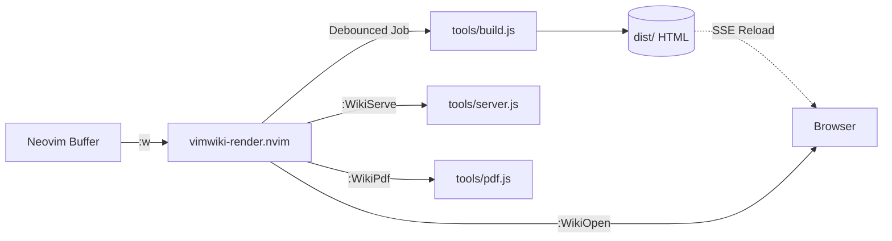

# vimwiki-render.nvim

An asynchronous, modern Neovim companion plugin for **Vimwiki** knowledge bases. It seamlessly connects Neovim to a static HTML generator, a live development server with Server-Sent Events (SSE) auto-reload, automated index synchronizers, and vector PDF exporters.

---

## ✨ Features

- ⚡ **Asynchronous Background Builds:** Automatically compiles markdown notes to responsive HTML on save (`:w`) without blocking Neovim.
- ⏱️ **Debounced Compilation:** Protects against rapid buffer saves by debouncing compilation requests.
- 🌐 **One-Key Browser Preview (`:WikiOpen`):** Instantly opens the exact HTML page corresponding to your current Markdown note.
- 🚀 **Live Dev Server Management (`:WikiServe`, `:WikiStop`):** Start and stop the local preview server with SSE hot reload directly from Neovim.
- 📑 **Folder Index Synchronizer (`:WikiSync` / `:WikiIndex`):** Auto-indexes new notes into their parent `index.md`.
- 📄 **Publication-Ready PDF Generator (`:WikiPdf`):** Exports individual notes or your entire wiki book to PDF via headless Chrome.
- 🎨 **Render-Markdown & Tree-sitter Compatibility:** Automatically configures composite filetypes (`tasks.vimwiki.markdown`) so [render-markdown.nvim](https://github.com/MeanderingProgrammer/render-markdown.nvim) and Tree-sitter work in harmony.
- 💻 **Cross-Platform:** Works on macOS, Linux, and Windows.

---

## 📦 Requirements

- **Neovim** >= 0.8.0 (0.10+ recommended for native `vim.ui.open`)
- **[vimwiki/vimwiki](https://github.com/vimwiki/vimwiki)**
- **Node.js** (for running `tools/build.js`, `tools/server.js`, and `tools/pdf.js`)

---

## 🚀 Installation

### Using [lazy.nvim](https://github.com/folke/lazy.nvim)

```lua
{
  "anoopar112/vimwiki-render.nvim",
  dependencies = { "vimwiki/vimwiki" },
  ft = { "markdown", "vimwiki" },
  opts = {
    -- Path to your Vimwiki repository (auto-detected from vim.g.vimwiki_list if omitted)
    wiki_path = "~/Documents/vimwiki",
    auto_compile = true,
  },
}
```

### Local Development / Testing in `lazy.nvim`

If you are developing or testing locally before pushing to GitHub:

```lua
{
  dir = "~/Documents/vimwiki-render.nvim",
  name = "vimwiki-render.nvim",
  dependencies = { "vimwiki/vimwiki" },
  ft = { "markdown", "vimwiki" },
  opts = {
    wiki_path = "~/Documents/vimwiki",
  },
}
```

### Using [packer.nvim](https://github.com/wbthomason/packer.nvim)

```lua
use({
  "anoopar112/vimwiki-render.nvim",
  requires = { "vimwiki/vimwiki" },
  config = function()
    require("vimwiki-render").setup({
      wiki_path = "~/Documents/vimwiki",
    })
  end,
})
```

### Using `vim-plug`

```vim
Plug 'vimwiki/vimwiki'
Plug 'anoopar112/vimwiki-render.nvim'

lua << EOF
require("vimwiki-render").setup({
  wiki_path = "~/Documents/vimwiki",
})
EOF
```

---

## ⚙️ Configuration & Defaults

All options are optional. If `wiki_path` is not provided, `vimwiki-render.nvim` automatically inspects `vim.g.vimwiki_list[1].path`.

```lua
require("vimwiki-render").setup({
  -- Path to your Vimwiki folder
  wiki_path = "~/Documents/vimwiki",

  -- Custom tool script overrides (default: <wiki_path>/tools)
  tools_dir = nil,
  dist_dir  = nil,
  pdf_dir   = nil,

  -- Node binary path
  node_bin = "node",

  -- Automatically build HTML on buffer write (:w)
  auto_compile = true,

  -- "all" (rebuilds entire wiki and search index) or "current" (rebuilds only the saved file)
  compile_mode = "all",

  -- Debounce delay (in milliseconds) for auto-compilation
  debounce_ms = 250,

  -- Display vim.notify notifications for build and server events
  notify = true,

  -- Custom browser open command (nil = auto-detect via vim.ui.open, open, or xdg-open)
  open_command = nil,

  -- Live development server options
  server = {
    port = 3000,
    auto_open = true,
  },

  -- Automatically sets buffer filetype to 'tasks.vimwiki.markdown' for render-markdown.nvim
  set_composite_filetype = true,

  -- Optional quick keybindings
  mappings = {
    enable = false,
    build  = "<leader>wb",
    open   = "<leader>wo",
    serve  = "<leader>ws",
    stop   = "<leader>wx",
    pdf    = "<leader>wp",
    sync   = "<leader>wi",
    status = "<leader>w?",
  },
})
```

---

## ⌨️ User Commands

| Command | Arguments | Description |
| :--- | :--- | :--- |
| `:WikiBuild` | `[all \| <file>]` | Compiles the wiki (or a specific file) to `dist/` |
| `:WikiOpen` | `[file]` | Opens the rendered HTML for the current note or wiki home |
| `:WikiServe` | — | Starts the live development server at `http://localhost:3000` |
| `:WikiStop` | — | Stops the live development server |
| `:WikiStatus` | — | Shows the current server status, notes count, and compiled HTML stats |
| `:WikiPdf` | `[book \| all \| <file>]` | Compiles notes to PDF using headless Chrome |
| `:WikiIndex` / `:WikiSync` | — | Scans note directories and synchronizes all folder `index.md` files |

---

## 🛠️ How It Works (Architecture)



1. **Auto-Save Hook:** When you edit any `.md` file inside your Vimwiki directory, `vimwiki-render.nvim` triggers a non-blocking `jobstart` to run `tools/build.js`.
2. **SSE Live-Reload:** If `:WikiServe` is active, `tools/server.js` detects the file update and broadcasts an SSE reload event, immediately updating your browser tab.
3. **Smart Linking:** `:WikiOpen` inspects the buffer name relative to `wiki_path` and resolves the corresponding `.html` artifact in `dist/`.

---

## 📄 License

MIT License. See [LICENSE](./LICENSE) for details.
